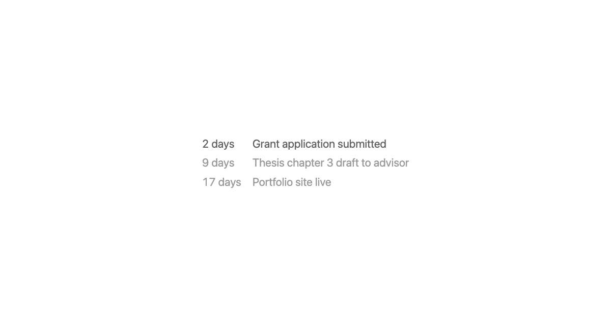

# Advertise to Yourself

A new tab page for Chrome and Arc that shows your own goals and the days left on each. Nothing else.

<picture>
  <source media="(prefers-color-scheme: dark)" srcset="docs/demo-dark.png">
  
</picture>

**[Live demo](https://rsktaker.github.io/advertise-to-yourself/)** · MIT license · no accounts, no tracking, no network calls

## Why

Opening a new tab is a small gap in your attention. You've finished one thing and haven't picked the next. Ad networks and news feeds are built around moments like this, which is why so many default new tab pages come filled with headlines, sponsored tiles and shopping.

Behavioral science has a name for a prompt that arrives when someone is able to act on it: a *just-in-time adaptive intervention*. Reminders work better when they show up at the moment you can act on them, and worse when they interrupt you somewhere you can't. The new tab is that moment, dozens of times a day, and by default it goes to somebody else's content.

This project uses that slot to advertise your own goals to yourself. Every tab you open is one quiet impression of what you said mattered and how much time is left. There are no notifications to dismiss, no streaks to break and no daily plan to fall behind on, so there's nothing to feel bad about. You just keep seeing it, the way ads work on everyone else.

## What it shows

```
2 days    Grant application submitted
9 days    Thesis chapter 3 draft to advisor
17 days   Portfolio site live
```

- One line per goal: days left, then the goal. At most 3 show at once, nearest deadline first.
- Each goal has a **shows from** date and a **due** date. It appears on the first and disappears the day after the second. Only what's relevant right now is on screen.
- The next goal due is slightly brighter. That's the only emphasis.
- Follows the system light/dark setting.
- Hover the bottom-right corner for **edit**.

## Install

```sh
git clone https://github.com/rsktaker/advertise-to-yourself ~/advertise-to-yourself
```

### Chrome

1. Open `chrome://extensions` and turn on **Developer mode**.
2. **Load unpacked** → select `~/advertise-to-yourself/extension`.
3. Turn off any other new tab extension (Chrome uses only one). If Chrome asks whether to keep the new tab page, choose **Keep it**.

The **+** button and **Cmd+T** both open your goals, and the address bar has focus, so you can type right away.

### Arc

Arc doesn't use new tab extensions: Cmd+T always opens its command bar. A [Hammerspoon](https://www.hammerspoon.org) hotkey takes over Cmd+T while Arc is the frontmost app and opens the page as a normal tab. The **+** button still opens the command bar.

```sh
brew install --cask hammerspoon
mkdir -p ~/.hammerspoon
cp ~/advertise-to-yourself/hammerspoon/advertise-to-yourself.lua ~/.hammerspoon/
echo 'require("advertise-to-yourself")' >> ~/.hammerspoon/init.lua
open -a Hammerspoon
```

Then turn on **Launch Hammerspoon at login** in its preferences. The first time you press Cmd+T in Arc, macOS asks whether Hammerspoon may control Arc. Allow it. Use **Cmd+L** to type a URL.

## Editing goals

Hover the bottom-right corner of the page and click **edit**. Each goal has a name, a shows-from date and a due date. **save** writes `extension/goals.js`, which both Chrome and Arc read, so an edit in one shows up in the other.

Saving goes through a small local server inside the Hammerspoon module, so in-page editing needs the Hammerspoon step above even if you only use Chrome. Without it, edit `extension/goals.js` by hand:

```js
const GOALS = [
  { title: "Grant application submitted", from: "2026-11-01", date: "2026-11-05" },
];
```

If a change doesn't show up in Chrome, reload the extension at `chrome://extensions`.

## How it works

| File | Purpose |
|---|---|
| `extension/manifest.json` | Chrome extension (MV3) that overrides the new tab page |
| `extension/newtab.html`, `script.js`, `style.css` | The page and the editor. Plain HTML/JS, no build step, no dependencies |
| `extension/goals.js` | Your goals. The only file that changes |
| `hammerspoon/advertise-to-yourself.lua` | Cmd+T in Arc, plus the save server |

The save server listens only on `localhost:47811`. It accepts requests only from the extension page and the `file://` page, so ordinary websites are rejected. It checks every goal (non-empty title, `YYYY-MM-DD` dates) and writes them as JSON-encoded data, so nothing else can be injected into `goals.js`.

To uninstall, remove the extension in `chrome://extensions`, delete the `require` line from `~/.hammerspoon/init.lua`, and delete the folder.

## Further reading

- Nahum-Shani et al. (2018). [Just-in-Time Adaptive Interventions (JITAIs) in Mobile Health: Key Components and Design Principles for Ongoing Health Behavior Support](https://doi.org/10.1007/s12160-016-9830-8). *Annals of Behavioral Medicine*.
- Rogers & Milkman (2016). [Reminders Through Association](https://repository.upenn.edu/oid_papers/294). *Psychological Science*.
- Altmann, Traxler & Weinschenk (2022). [Deadlines and Memory Limitations](https://doi.org/10.1287/mnsc.2021.4227). *Management Science*.

## License

[MIT](LICENSE)
